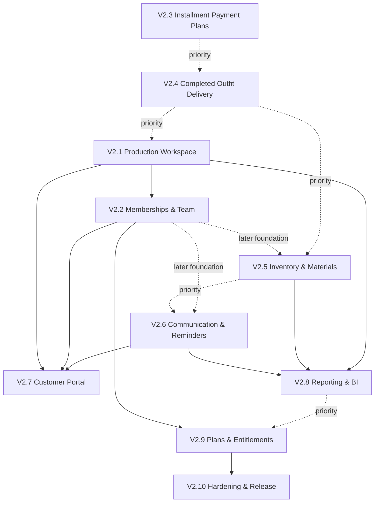

# FashionOS Version 2 roadmap

Status: Inventory & Materials and Communication & Reminders are implemented in the workspace; validation and release remain. The user selected these two features to implement next, ahead of the earlier membership-first sequence. Their current actor and tenant context uses the authenticated V1 `User` and `Business`; a later membership migration must preserve historical actors and stock/communication records.

## Implementation priority and dependencies

The diagram shows the current product priority. Dotted arrows mean product priority; solid arrows mean a technical dependency. Inventory and Communication currently use the existing tenant and permission model. Communication follows Inventory by priority, not because it depends on it technically.

V2.3 and V2.4 use existing Orders and Finance contracts and do not technically require V2.1 or V2.2. V2.1 production records the authenticated `User` as actor and deliberately leaves assignment absent. V2.2 later adds `assigned_membership_id` to production work items without replacing their identity or history. Inventory and Communication now use the current authenticated `User`/`Business` context; future membership work may add workspace switching and finer permissions without changing their historical records. Communication follows Inventory by product priority, not technical dependency. Portal and Reporting consume explicit projections rather than operational tables directly from the browser.

## V2.1 — Production Workspace

**Status:** PLANNED

**Goal:** give a fashion business an item-level, mobile-capable view of garments moving independently through production.

**Primary entities:** `ProductionWorkItem`, `ProductionActivity`; existing `OrderItem`, `Order`, `Customer`, and `User` remain sources of context.

**Dependencies:** V1 Orders, CRM read context, tenant resolution, timezone helpers. No membership dependency.

**Major APIs:** paginated/filterable production board; production work-item detail; stage, priority, due-date override, and note commands; paginated activity.

**Frontend surfaces:** `/production` board, accessible stage-change dialog/action, work-item detail/activity panel, order-detail production summary.

**Explicit non-goals:** granular tasks, staff assignment, custom stages, time tracking, drag-and-drop-only interaction, inventory usage, customer visibility, automation.

## V2.2 — SaaS Memberships & Team Management

**Status:** IN PROGRESS — compatibility membership records, legacy-account backfill, and secure invitations for new accounts are implemented; invitations to existing accounts, membership-scoped authorization, workspace switching, and membership audit history remain.

**Goal:** separate global user identity from business membership and introduce secure multi-business workspaces and backend permissions.

**Primary entities:** `BusinessMembership`, `BusinessInvitation`, membership audit records; transitional `User.business_id`/`User.role` remain until compatibility is proven.

**Dependencies:** V1 Identity/Tenant and the assignment compatibility point designed in V2.1.

**Major APIs:** list members/invitations, invite/accept/revoke, change role/status, list/switch workspaces, current actor/session.

**Frontend surfaces:** `/team`, invitation acceptance, workspace switcher, permission-aware navigation/actions.

**Explicit non-goals:** payroll, shifts, performance management, custom roles/permission editor, production time sheets.

## V2.3 — Installment Payment Plans

**Status:** IN PROGRESS, plan creation and scheduled payment allocation are being implemented

**Goal:** let a business collect an advance payment and define/track an agreed payment schedule for the remaining order balance, including installment due dates and progress.

**Baseline:** V1 already accepts multiple manual partial payments and derives amount paid and balance from successful payment records. V2.3 adds a formal schedule and installment tracking; it must not add an editable `amount_paid` or replace the payment ledger as the financial source of truth.

**Primary entities:** business payment-plan settings, `PaymentPlan`/installment schedule and installment due entries linked to an order and business; successful `Payment` rows remain authoritative for collections.

**Owner policy:** payment plans default to `OPTIONAL` for a business. The business owner can keep them optional or switch the policy to `REQUIRED` for new orders. Existing orders are not retroactively changed by a policy update. The advance amount itself is always optional, including when a schedule is required; if no advance is set, scheduled installments cover the full order total.

**Dependencies:** V1 Orders and Finance calculations, business currency and timezone helpers. No technical dependency on V2.2 Memberships, though implementation is sequenced after it.

**Major APIs:** read/update the business policy for whether installment plans are optional or required; create and retrieve an order payment schedule with an optional advance amount; allocate successful payments across the advance and earliest unpaid installments; expose due, paid, partially paid, and overdue installment projections; revise or cancel a schedule under explicit rules; retain schedule change history.

**Frontend surfaces:** owner-controlled payment policy in business settings; advance and installment-plan setup on order creation/detail when allowed or required by that policy; installment schedule and status on order/invoice finance views; record-payment flow that attributes successful payments to the advance or scheduled installments where applicable.

**Explicit non-goals:** automatic card debits, payment gateway selection, editable balances, late fees, or treating a planned installment as a received payment.

**Decisions before implementation:** minimum or percentage advance rules; fixed versus variable installment amounts; whether due dates/amounts can be revised after payments; how existing partial payments fit a newly created plan; and how overdue state is calculated in business-local time.

## V2.4 — Completed Outfit Delivery

**Status:** IN PROGRESS

**Goal:** let a business record how a completed outfit will be handed to the customer and track the handoff through completion.

**Primary entities:** order-linked fulfillment choice and event history. The first implementation supports customer pickup and business delivery, with recipient details, delivery address/instructions, optional tracking reference, dispatch time, and confirmed handoff time.

**Dependencies:** V1 Orders and order status history. V2.1 Production provides item-level readiness if partial-garment handoff is later required; the initial slice should remain order-level and require the order to be `READY` before delivery is dispatched/completed. No technical dependency on V2.2 Memberships.

**Major APIs:** set or revise fulfillment method before dispatch; record delivery dispatch and pickup/delivery handoff; retrieve tenant-scoped fulfillment details and actor history. Delivery charges are not included in this slice.

**Frontend surfaces:** fulfillment choice/details on order creation or detail, ready-order handoff controls, delivery status and history for staff.

**Explicit non-goals:** courier marketplace, route optimization, live GPS tracking, automatic courier booking, or marking an order delivered before its completion event.

**Current boundaries:** delivery is arranged by the business; address and recipient details are stored per order; an optional tracking reference can be recorded. Delivery charges and required proof-of-delivery capture are separate business toggles, default off. Charges are included in order and invoice totals. Orders can only be marked delivered through the recorded handoff flow.

## V2.5 — Inventory & Materials

**Status:** IN PROGRESS — workspace implementation complete; validation and release pending.

**Goal:** track materials with an auditable movement ledger and associate material usage with orders without changing order ownership.

**Primary entities:** `InventoryItem`, `Supplier`, `StockMovement`, `OrderMaterialUsage`.

**Dependencies:** current authenticated tenant and role permissions, Orders references, PostgreSQL row locking. Membership-based permissions can replace the current role source later without replacing ledger history.

**Major APIs:** item/supplier maintenance, receive/consume/adjust movements, order material usage, and low-stock filtering. Stock quantity is derived from append-only movements; order consumption locks the item row and rejects negative stock.

**Frontend surfaces:** `/inventory`, item detail/ledger, receive/adjust dialogs, order material allocation.

**Explicit non-goals:** procurement automation, supplier marketplace, warehouse network, barcode hardware, silent stock overwrite.

## V2.6 — Customer Communication & Reminders

**Status:** IN PROGRESS — workspace implementation complete; validation and release pending.

**Goal:** create tenant-owned, auditable customer communication using provider-independent channels and useful order/payment context.

**Primary entities:** `MessageTemplate`, `Communication`, optional delivery-attempt history; channel/status enums.

**Dependencies:** current authenticated tenant and role permissions, CRM contacts, Orders context, and Finance read context. Membership-based permissions can replace the current role source later. Sequenced after Inventory per product priority; it does not technically depend on Inventory.

**Major APIs:** template CRUD/archive, message preparation, auditable send outcome, communication history, and business-local reminder candidates for order balances, advances, and installments.

**Frontend surfaces:** `/communication`, templates, customer/order communication history, explicit send/handoff confirmation.

**Explicit non-goals:** marketing automation suite, inbound support inbox, provider lock-in, bulk unsolicited messaging. WhatsApp, SMS, and email are prepared as explicit device/app handoffs; FashionOS does not automatically send messages.

## V2.7 — Customer Portal

**Status:** PLANNED, product scope still requires validation

**Goal:** expose a deliberately limited, revocable customer-safe view of selected order/invoice information.

**Primary entities:** portal access grant/token digest and revocation/expiry metadata; customer-safe read projections.

**Dependencies:** V2.2 tenant model, V2.6 communication for link delivery where used, Orders/Finance/Production safe read contracts, and V2.4 fulfillment details only if customer delivery status is included in the validated portal scope.

**Major APIs:** create/revoke access, exchange/validate token, fetch explicitly scoped portal summary/order/invoice data.

**Frontend surfaces:** internal portal-access controls and isolated public portal routes.

**Explicit non-goals:** customer account passwords, exposing internal UUIDs as credentials, internal notes/staff details, unrelated customer orders, e-commerce storefront.

## V2.8 — Reporting & Business Intelligence

**Status:** PLANNED, metrics require validation

**Goal:** provide decision-useful tenant reports from stable operational data with explicit metric definitions.

**Primary entities:** primarily read models/query DTOs; saved report preferences only if validated.

**Dependencies:** stable CRM, Orders, Production, Inventory, Finance, and Communication schemas.

**Major APIs:** bounded time-range summaries, production throughput, revenue/receivables, customer/order trends, inventory movement summaries.

**Frontend surfaces:** `/reports` with accessible tables/charts and export only where validated.

**Explicit non-goals:** warehouse, Kafka, streaming, OLAP platform, predictive analytics, a broad custom report builder.

## V2.9 — SaaS Plans & Entitlements

**Status:** PLANNED, commercial packaging requires validation

**Goal:** enforce provider-independent feature/usage capabilities for each tenant.

**Primary entities:** `Plan`, `Subscription`, `Entitlement`, `Usage`, subscription lifecycle history.

**Dependencies:** V2.2 Tenant/Membership and stable feature boundaries from earlier V2 modules.

**Major APIs:** current capabilities/usage, plan administration surface if required, provider webhook adapter endpoints only after a provider is selected.

**Frontend surfaces:** capability-aware UX, subscription/settings summary, upgrade messaging after commercial validation.

**Explicit non-goals:** hardcoding Stripe/Paystack into operational modules, accounting ledger, complex metered billing engine, client-side-only enforcement.

## V2.10 — V2 Hardening & Release

**Status:** PLANNED

**Goal:** integrate, secure, performance-test, migrate, document, and release the validated V2 scope.

**Primary entities:** none by default; only corrective schema changes supported by release findings.

**Dependencies:** V2.1–V2.9 completed or explicitly descoped.

**Major APIs:** no new feature family; compatibility, health, operational, and security corrections only.

**Frontend surfaces:** cross-module accessibility/mobile/print/error review and release polish, not redesign.

**Explicit non-goals:** adding postponed features during stabilization, microservices, Kubernetes, speculative scale infrastructure.

## Roadmap governance

- A session may narrow an unvalidated feature but must not silently reorder the locked sequence.
- Each implementation session requires tenant-isolation, permission, migration rollback, concurrency, mobile/accessibility, and cache-invalidation tests appropriate to its scope.
- V2.10 depends on V2.1–V2.9 being completed or explicitly descoped, unresolved critical data/security issues being closed, and migration rehearsals passing on production-like PostgreSQL.
