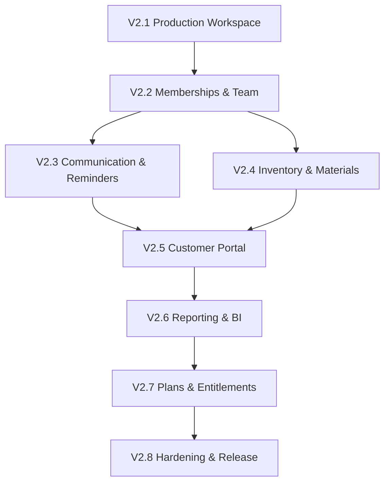

# FashionOS Version 2 roadmap

Status: architecture approved for implementation sequencing on `docs/v2-architecture`. V1 remains frozen at `v0.1.0-mvp`; this roadmap does not mark unimplemented product assumptions as validated.

## Dependency map

The implementation order is locked. V2.3 and V2.4 are conceptually parallel after V2.2, but sessions remain sequential to keep migrations and release review bounded.

V2.1 does not require memberships: it records the existing authenticated `User` as actor and deliberately leaves assignment absent. V2.2 later adds `assigned_membership_id` to the production work item without replacing its identity or history. Communication and Inventory require the V2.2 permission/actor context. Portal and Reporting consume explicit projections rather than operational tables directly from the browser.

## V2.1 — Production Workspace

**Status:** PLANNED

**Goal:** give a fashion business an item-level, mobile-capable view of garments moving independently through production.

**Primary entities:** `ProductionWorkItem`, `ProductionActivity`; existing `OrderItem`, `Order`, `Customer`, and `User` remain sources of context.

**Dependencies:** V1 Orders, CRM read context, tenant resolution, timezone helpers. No membership dependency.

**Major APIs:** paginated/filterable production board; production work-item detail; stage, priority, due-date override, and note commands; paginated activity.

**Frontend surfaces:** `/production` board, accessible stage-change dialog/action, work-item detail/activity panel, order-detail production summary.

**Explicit non-goals:** granular tasks, staff assignment, custom stages, time tracking, drag-and-drop-only interaction, inventory usage, customer visibility, automation.

## V2.2 — SaaS Memberships & Team Management

**Status:** PLANNED

**Goal:** separate global user identity from business membership and introduce secure multi-business workspaces and backend permissions.

**Primary entities:** `BusinessMembership`, `BusinessInvitation`, membership audit records; transitional `User.business_id`/`User.role` remain until compatibility is proven.

**Dependencies:** V1 Identity/Tenant and the assignment compatibility point designed in V2.1.

**Major APIs:** list members/invitations, invite/accept/revoke, change role/status, list/switch workspaces, current actor/session.

**Frontend surfaces:** `/team`, invitation acceptance, workspace switcher, permission-aware navigation/actions.

**Explicit non-goals:** payroll, shifts, performance management, custom roles/permission editor, production time sheets.

## V2.3 — Customer Communication & Reminders

**Status:** PLANNED

**Goal:** create tenant-owned, auditable customer communication using provider-independent channels and useful order/payment context.

**Primary entities:** `MessageTemplate`, `Communication`, optional delivery-attempt history; channel/status enums.

**Dependencies:** V2.2 actor/permissions, CRM contacts, Orders context, Finance read context.

**Major APIs:** template CRUD/archive, preview, create/send or hand off, communication history, reminder candidates.

**Frontend surfaces:** `/communication`, templates, customer/order communication history, explicit send/handoff confirmation.

**Explicit non-goals:** marketing automation suite, inbound support inbox, provider lock-in, bulk unsolicited messaging. Automated WhatsApp provider delivery is not assumed; a WhatsApp handoff can be the first validated slice.

## V2.4 — Inventory & Materials

**Status:** PLANNED

**Goal:** track materials with an auditable movement ledger and associate material usage with orders without changing order ownership.

**Primary entities:** `InventoryItem`, `Supplier`, `StockMovement`, `OrderMaterialUsage`.

**Dependencies:** V2.2 actor/permissions, Orders references, PostgreSQL concurrency safeguards.

**Major APIs:** item/supplier lists and maintenance, receive/consume/adjust movements, order allocation/usage, low-stock query.

**Frontend surfaces:** `/inventory`, item detail/ledger, receive/adjust dialogs, order material allocation.

**Explicit non-goals:** procurement automation, supplier marketplace, warehouse network, barcode hardware, silent stock overwrite.

## V2.5 — Customer Portal

**Status:** PLANNED, product scope still requires validation

**Goal:** expose a deliberately limited, revocable customer-safe view of selected order/invoice information.

**Primary entities:** portal access grant/token digest and revocation/expiry metadata; customer-safe read projections.

**Dependencies:** V2.2 tenant model, V2.3 communication for link delivery where used, Orders/Finance/Production safe read contracts.

**Major APIs:** create/revoke access, exchange/validate token, fetch explicitly scoped portal summary/order/invoice data.

**Frontend surfaces:** internal portal-access controls and isolated public portal routes.

**Explicit non-goals:** customer account passwords, exposing internal UUIDs as credentials, internal notes/staff details, unrelated customer orders, e-commerce storefront.

## V2.6 — Reporting & Business Intelligence

**Status:** PLANNED, metrics require validation

**Goal:** provide decision-useful tenant reports from stable operational data with explicit metric definitions.

**Primary entities:** primarily read models/query DTOs; saved report preferences only if validated.

**Dependencies:** stable CRM, Orders, Production, Inventory, Finance, and Communication schemas.

**Major APIs:** bounded time-range summaries, production throughput, revenue/receivables, customer/order trends, inventory movement summaries.

**Frontend surfaces:** `/reports` with accessible tables/charts and export only where validated.

**Explicit non-goals:** warehouse, Kafka, streaming, OLAP platform, predictive analytics, a broad custom report builder.

## V2.7 — SaaS Plans & Entitlements

**Status:** PLANNED, commercial packaging requires validation

**Goal:** enforce provider-independent feature/usage capabilities for each tenant.

**Primary entities:** `Plan`, `Subscription`, `Entitlement`, `Usage`, subscription lifecycle history.

**Dependencies:** V2.2 Tenant/Membership and stable feature boundaries from earlier V2 modules.

**Major APIs:** current capabilities/usage, plan administration surface if required, provider webhook adapter endpoints only after a provider is selected.

**Frontend surfaces:** capability-aware UX, subscription/settings summary, upgrade messaging after commercial validation.

**Explicit non-goals:** hardcoding Stripe/Paystack into operational modules, accounting ledger, complex metered billing engine, client-side-only enforcement.

## V2.8 — V2 Hardening & Release

**Status:** PLANNED

**Goal:** integrate, secure, performance-test, migrate, document, and release the validated V2 scope.

**Primary entities:** none by default; only corrective schema changes supported by release findings.

**Dependencies:** V2.1–V2.7 completed or explicitly descoped.

**Major APIs:** no new feature family; compatibility, health, operational, and security corrections only.

**Frontend surfaces:** cross-module accessibility/mobile/print/error review and release polish, not redesign.

**Explicit non-goals:** adding postponed features during stabilization, microservices, Kubernetes, speculative scale infrastructure.

## Roadmap governance

- A session may narrow an unvalidated feature but must not silently reorder the locked sequence.
- Each implementation session requires tenant-isolation, permission, migration rollback, concurrency, mobile/accessibility, and cache-invalidation tests appropriate to its scope.
- V2.8 begins only after unresolved critical data/security issues are closed and migration rehearsals pass on production-like PostgreSQL.
