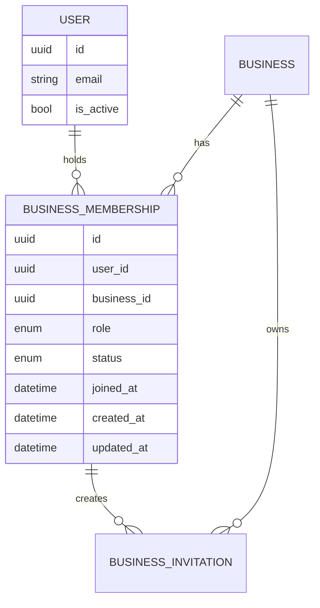

# Membership architecture and V1 migration plan

## Implemented V1 starting point

V1 combines identity and tenancy on `User`: a non-null `User.business_id`, `User.role` (`OWNER`/`STAFF`), and globally unique email. Authentication JWTs identify only the user; `get_current_business` returns `current_user.business`. There is no membership, invitation, workspace switch, or backend permission enforcement. Registration is the only public user-creation path and always creates an owner, but the database enum permits legacy/manual `STAFF` rows.

## Target model

`User` becomes global identity/credentials. `BusinessMembership` becomes the only long-term relationship that grants a user access to a business.

Conceptual membership fields:

- `id`, `user_id`, `business_id`;
- `role`: `OWNER`, `MANAGER`, `TAILOR`, `ACCOUNTANT`;
- `status`: `ACTIVE`, `SUSPENDED`, `REVOKED` (pending invitations live separately);
- `joined_at`, `created_at`, `updated_at`;
- optional `invited_by_membership_id` for attribution after invitation acceptance.

`STAFF` is not retained as a target role because it is operationally ambiguous and cannot support least privilege. Pending email invitations are separate `BusinessInvitation` records with business, normalized email, offered role, hashed token, expiry, status, and inviter membership. A membership is created only when a matching user accepts.

## Constraints and invariants

- Unique `(user_id, business_id)`; one relationship row changes status rather than accumulating duplicate active rows.
- Index `(business_id, status, role)` for team lists and authorization.
- Active access requires active `User` and active `BusinessMembership`.
- Only an active owner can grant/revoke owner. The service locks active owner memberships and rejects suspension/revocation/demotion of the last active owner.
- A business must have at least one active owner after every committed membership mutation. This transactional invariant cannot be expressed safely as a simple check constraint.
- Invitation token plaintext is shown/sent once; only a cryptographic digest is stored. Invitations are expiring, single-use, revocable, rate-limited, and unique per pending `(business_id, normalized_email)`.
- Acceptance requires the authenticated/verified user email to match the invitation. Existing membership acceptance is idempotent and cannot change a role silently.
- Membership IDs may be sent as selectors, but never authorize without a server query matching both current user and active status.

## Staged migration

Session 0 performs none of these steps.

### Migration A — additive membership schema and backfill

1. Create membership enums/table, constraints, indexes, and membership audit support.
2. Inventory V1 users by role, activity, business validity, and duplicate email; abort on orphaned business references or unexpected role values.
3. Backfill one membership per valid V1 user:
   - V1 `OWNER` -> active `OWNER` membership.
   - V1 `STAFF` -> active `MANAGER` membership as the closest compatibility role for V1's unrestricted operational access, **not** owner. Produce a review report before applying; a business owner may deliberately remap specific people to `TAILOR` or `ACCOUNTANT` after V2.2 permissions are enabled.
4. Set `joined_at` from `User.created_at`; `invited_by_membership_id` is null for backfilled rows.
5. Verify counts: every active user has exactly one active membership for `User.business_id`, and every business has an active owner. Businesses with only legacy STAFF are a blocking data anomaly requiring an explicit owner decision.
6. Keep `User.business_id` and `User.role` intact. Add dual-read comparison telemetry/tests but do not dual-write arbitrary tenant changes.

The generic recommendation to backfill every user as owner is rejected because the real V1 schema contains `STAFF`; elevating such rows would create a privilege escalation.

### Application transition

1. Introduce an `ActorContext(user, membership, business, permissions)` dependency.
2. Login/refresh without a membership claim selects the sole active membership when exactly one exists. For multiple memberships, use the last valid membership if securely remembered or require explicit selection.
3. Auth session responses include active membership plus available workspace summaries. Remove browser dependence on `user.business_id` while keeping it in compatibility responses temporarily.
4. Every authenticated route resolves business through the active membership and enforces a named permission at the backend.
5. Workspace switching validates membership and rotates both tokens. Clear all tenant-owned frontend Query caches before loading the selected workspace.
6. Add `assigned_membership_id` to production work items and membership context to new production activities. Existing V2.1 actor-user history remains unchanged.
7. Run compatibility tests comparing legacy business resolution to membership resolution for all backfilled users, plus cross-business and inactive/suspended cases.

### Migration B — remove legacy tenancy from User

Only after at least one release proves membership-based resolution and rollback rehearsals:

1. Stop returning/reading `User.business_id` and `User.role` in application code.
2. Verify no foreign key or query still treats them as authorization.
3. Drop/deprecate the columns and old `user_role` enum in a reviewed migration.
4. Preserve stable `User.id` references on historical records; do not rewrite measurement, order, payment, invoice, or production actors solely to membership IDs.

## Active workspace representation

Recommended cookie/JWT flow:

1. Access and refresh tokens retain `sub = user_id` and add `mid = active_membership_id`.
2. `POST /auth/workspace` accepts a membership ID as a selector.
3. The server queries `BusinessMembership.id == mid`, `user_id == sub`, and `status == ACTIVE`, loads the business and current role, then rotates both HTTP-only cookies.
4. Every request reloads/validates the membership; signed claims select a workspace but do not freeze role/status authorization until token expiry.
5. The browser never submits a raw `business_id` to normal domain APIs. A stale, suspended, foreign, or forged membership produces `401/403` at the session boundary without revealing another tenant.

This provides explicit workspace selection without a new server-session datastore. If later security requirements demand immediate device revocation, a server-side session table keyed by a signed opaque session ID can replace token-only session selection without changing memberships.

## Role transition

Target roles are:

- `OWNER`: business governance, team, settings, subscription, and all operational permissions.
- `MANAGER`: broad operational administration without ownership/subscription authority.
- `TAILOR`: customer/measurement context and production execution.
- `ACCOUNTANT`: financial recording/invoicing/reporting with read-only operational context.

The authoritative permission matrix is `ROLE_PERMISSION_MATRIX.md`. Roles are coarse product roles; V2 does not include custom role editing.

## Invitation edge cases

- **Email not registered:** invitation remains pending; acceptance creates/links identity only after the email is verified through the selected authentication flow.
- **Email already registered:** acceptance adds a membership; it never changes existing memberships.
- **Already a member:** return an idempotent success for the same active role or a conflict requiring a deliberate role-change command.
- **Duplicate invitations:** enforce one live invitation per business/email; resend rotates token/expiry and records an audit entry.
- **Expired/revoked/used token:** generic invalid-invitation response; do not reveal membership data.
- **Inviter suspended:** outstanding invitations may be revoked by policy or require owner reapproval; decide during V2.2 implementation and test explicitly.
- **Cross-business invitation:** inviter and invitation business come from the active membership, never payload `business_id`.
- **Last owner:** cannot accept a change that leaves no active owner; ownership transfer is one locked transaction.

## Rollback plan

- Before Application transition, Migration A is additive; application rollback ignores membership tables. Keep the backfill report and do not drop V1 columns.
- During transition, retain a feature flag/emergency deployment that resolves the V1 business only for records whose membership comparison passed. Do not silently fall back when membership data conflicts; fail closed and repair data.
- Role/status mutations made after V2.2 cannot be represented completely by V1 columns. Once team changes are enabled, application rollback must either keep membership authorization active or replay a reviewed compatibility mapping—not discard membership state.
- Migration B is not in the same release as initial membership rollout. Restore from backup or roll forward if its removal migration fails; automatic destructive downgrade is prohibited.

## Required migration tests for V2.2

- Backfill counts and role mapping on production-like PostgreSQL.
- No active user without membership; no business without active owner.
- Unique user/business membership and duplicate invitation races.
- Locked last-owner demotion/suspension concurrency.
- Workspace switching, stale/suspended membership, cross-user membership ID, and token rotation.
- Every existing tenant-scoped endpoint under the membership actor context.
- Frontend cache isolation across workspace switches.
