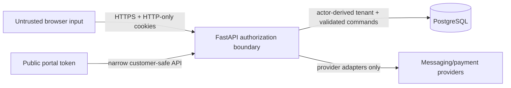

# V2 architecture security threat review

This is a lightweight design review, not a penetration test. Controls remain subject to implementation tests and deployment review.

## Trust boundaries

- The browser can select a workspace/resource but cannot assert tenant, actor, role, permission, price totals, balances, stock totals, communication status, or entitlements.
- FastAPI resolves authentication, active membership, tenant, permission, entitlement, and resource ownership before domain mutation.
- External provider callbacks are untrusted until their signature, replay/idempotency key, expected tenant mapping, and state transition are validated.

## Threats and required controls

| Threat | Required architecture control | Verification |
| --- | --- | --- |
| Cross-tenant production access | Query production work item by `(business_id, id)`; validate linked order/customer context; `404` for foreign IDs. | Endpoint/service tests for read, move, note, priority, due date, activity. |
| Role escalation | Fixed role enum, named backend permissions, membership reload each request, owner-only role governance, append-only role audit. | Matrix tests and direct API attempts from every role. |
| Invitation abuse/token theft | Random single-use token, digest at rest, expiry/revocation, email binding, rate limit, no token logging, duplicate-pending constraint. | Wrong email, replay, expiry, resend race, foreign tenant tests. |
| Last-owner loss | Lock active owners; reject final owner demotion/suspension/revocation in one transaction. | PostgreSQL concurrency test. |
| Workspace tampering/cache leakage | Validate selected membership belongs to user and is active; rotate cookies; clear tenant frontend caches. | Forged/stale membership tests and two-workspace UI test. |
| Stale board overwrite | Integer version and compare-and-update; `409` stale response; atomic activity append. | Concurrent stage/priority mutation test. |
| Internal-note disclosure | Separate production activity schema; omit notes from invoice, communication, reporting exports unless explicit, and portal schemas always. | Schema snapshots and portal contract tests. |
| Portal token leakage | Store digest, high entropy, scope, expiry, revoke, rate limit, safe referrer/logging policy; UUID alone never authorizes. | Token enumeration/replay/revocation and unrelated-order tests. |
| Inventory manipulation | Permissioned append-only movements, reason/reference, actor, idempotency, row locking/constraint against invalid stock policy. | Concurrent consumption/adjustment and immutable ledger tests. |
| Communication spoofing | Tenant-owned approved templates, recipient snapshot, explicit confirmation, provider adapter, signed callbacks, attempt history. | Cross-tenant template/recipient and forged callback tests. |
| Finance privilege bypass | Separate read/record/issue permissions, tenant predicate, Decimal calculations, row locks, immutable successful payments. | Role/cross-tenant and overpayment races. |
| Entitlement bypass | Backend capability service at use-case boundary; webhook updates subscription state idempotently; frontend gating is secondary. | Direct API calls without entitlement and forged webhook tests. |

## Actor and audit requirements

Audit actor information is required for membership invitations/acceptance, role/status changes, production stage/priority/due/note/assignment, stock movements, communication attempts, and subscription changes. System actions have an explicit system reason and nullable user rather than a fabricated user.

Use domain-specific immutable records, not a universal payload dump. Never store passwords, JWTs, invitation/portal token plaintext, auth cookies, provider secrets, or full connection strings in audit/log columns.

## Security decisions deferred to their session

- V2.2 chooses invitation delivery and account-email verification mechanics.
- V2.3 selects any messaging provider and callback verification scheme.
- V2.4 decides whether negative stock is forbidden or permissioned as an audited exception.
- V2.5 sets portal token lifetime/scope and referrer policy after final hosting topology.
- V2.7 selects a billing provider, if any, without changing entitlement interfaces.

None of these deferred provider/product choices blocks the V2.1 production workspace.
