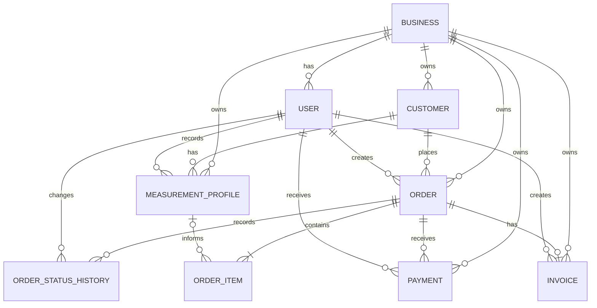

# FashionOS V1 domain baseline

This document records the implemented `v0.1.0-mvp` architecture that V2 inherits. The code and migrations at tag `v0.1.0-mvp` are authoritative; proposed V2 entities are intentionally absent here.

## Identity

`User` is both a global login identity and a tenant member in V1. Each user has one non-null `business_id`, one `UserRole` (`OWNER` or `STAFF`), an Argon2 password hash, and an `is_active` flag. Email is globally unique. Registration creates one `Business` and one active `OWNER` in one transaction. There are no invitations, memberships, workspace switching, or role-based permission checks.

Authentication uses short-lived access and refresh JWTs stored only in HTTP-only cookies. Both tokens contain the user UUID as `sub`; they do not contain a browser-supplied tenant identifier. Login, refresh, and `/auth/me` load the user and its single business from PostgreSQL. The frontend keeps the returned `user` and `business` in the TanStack Query entry `['auth', 'session']`.

## Tenant resolution

`get_current_user` validates the access cookie, parses the subject UUID, loads an active user, and eager-loads `User.business`. `get_current_business` returns that relationship. Route handlers pass this server-derived `Business` into services. Tenant-owned service queries explicitly filter `business_id == business.id`; cross-tenant identifiers normally return `404`.

V1 therefore has a sound single-business tenant rule but no reusable actor/permission context. The helper `tenant_filter` exists, although most services write explicit predicates. Several records also carry `business_id` alongside order/customer foreign keys for direct scoping, with consistency enforced in services rather than composite foreign keys.

## Domain diagram

## CRM

`Customer` belongs directly to a business. Phone uniqueness is `(business_id, phone_normalized)`. Search is bounded and tenant scoped. Customer deletion is not exposed: archive and restore mutate `archived_at`, and default lists exclude archived records. An archived customer cannot receive a new measurement or order.

`MeasurementTemplate` is either global (`business_id IS NULL`) or business-owned. `MeasurementProfile` belongs to both a business and customer, optionally references a template, stores the recording user/time, and owns ordered `MeasurementValue` rows using exact `NUMERIC(8,2)` values. There is no measurement-edit endpoint. A corrected measurement is represented by a new profile, while prior profiles remain available or can be archived/restored. This is snapshot-style history rather than a separate change log.

## Orders

`Order` is the customer-level commercial/workflow aggregate. It owns a business-scoped generated order number, customer, order/due dates, notes, discount, creator, lifecycle timestamps, one or more items, payments, and at most one invoice. Order counters are business-scoped and row locked.

`OrderItem` is a line within an order. It represents a garment type or a batch of the same garment (`quantity >= 1`), description, price, optional measurement profile, style URL, notes, and display position. It does not carry `business_id`; tenant ownership is reached through its order. The linked measurement profile is validated to belong to the same business and same customer.

The order update API can change the due date, notes, discount, and item prices. It does not add, remove, split, or independently progress items after creation. Delivered and cancelled orders are terminal and financially locked.

## Production

V1 uses one `OrderStatus` enum for intake, shop-floor stages, and fulfillment:

`DRAFT`, `CONFIRMED`, `CUTTING`, `SEWING`, `FITTING`, `FINISHING`, `READY`, `DELIVERED`, `CANCELLED`.

Transitions are validated by `ORDER_TRANSITIONS`. Every order change appends `OrderStatusHistory`, then copies the same status to all `OrderItem.status` fields. Although `OrderItem.status` exists, V1 has no item-level status endpoint, independent item transition rules, assignment, priority, production note stream, task, or item history. Consequently, an order containing several garments cannot represent different garment stages. V1 “production tracking” is an order-wide workflow summary, not a production workspace.

## Finance

Prices and discounts use `NUMERIC(12,2)`/`Decimal`. The authoritative paid amount is the sum of `SUCCESSFUL` `Payment` rows; there is no editable `amount_paid`. A payment is an append-only manual ledger entry through the public API, records the authenticated receiving user, and cannot be updated or deleted. PostgreSQL row locking prevents concurrent overpayment.

One `Invoice` may exist per order. Invoice numbers use a business-scoped locked counter. Invoice status is synchronized and defensively derived from live order totals and successful payments. Invoice line data is projected from current order items rather than copied into invoice lines; terminal financial locking preserves delivered/cancelled stability.

## Settings

`Business` stores identity, contact details, a URL-based logo, currency, IANA timezone, default invoice notes, and invoice footer. `GET/PATCH /business` derives the business from the authenticated user and forbids extra payload fields such as `business_id`. Currency and timezone are validated at the API boundary. A successful frontend update refreshes the business settings cache, auth session cache, dashboard, order, invoice, and payment-dependent queries.

## Existing history and deletion semantics

| Concern | Implemented behavior |
| --- | --- |
| Order status | Append-only `OrderStatusHistory`, including actor, timestamp, transition, and optional notes. |
| Payments | Immutable API-level ledger rows; successful rows are the source of truth. |
| Measurements | Append new profiles rather than edit values; recorder/time retained; profiles can be archived/restored. |
| Customers | Soft archive via `archived_at`; no hard-delete API. |
| Measurement profiles | Soft archive via `archived_at`; no hard-delete API. |
| Orders/invoices | No delete API; delivered/cancelled order states are terminal. |
| General audit | No generic audit-event system, membership audit, or production-item activity stream. |

## Frontend baseline

React Router separates public login/register routes from an authenticated `AppShell`. The shell currently exposes Dashboard, Customers, Measurements, Orders, and Settings. TanStack Query owns server state; typed API modules call a cookie-credentialed Axios client, and mutations explicitly invalidate affected aggregates. Tables have mobile card alternatives, shared UI primitives provide loading/error/empty/dialog patterns, and currency/time formatting is centralized.

The order detail surface currently combines order status, garments, payments, invoice generation, financial summary, and order-level status history. V2.1 must add `/production` without changing the meaning of these existing financial and customer-facing surfaces accidentally.

## Baseline constraints carried into V2

- Tenant identity always comes from an authenticated server-validated context, never a raw browser `business_id`.
- Cross-tenant resource misses remain `404`.
- Existing order/invoice numbers and counters remain business scoped.
- Money remains Decimal-backed; business-local dates use centralized timezone helpers.
- Payments, stock movements, and meaningful histories are append-oriented.
- V2 must preserve V1 users, orders, measurements, invoices, payments, and the existing cookie session during staged migrations.

## Documented V1 limitations, not assumed V2 capabilities

- `OWNER` and `STAFF` are data labels only; every authenticated user can currently reach every authenticated API.
- A user can belong to exactly one business.
- Item status is only a synchronized copy of order status.
- No staff assignment, production priority, production-specific due date, inventory, communication, portal, reporting module, or entitlement model exists.
- Tenant consistency across redundant foreign keys is primarily enforced in services rather than by composite database constraints.
