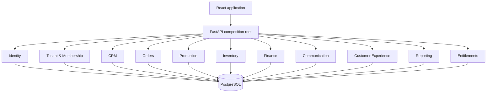
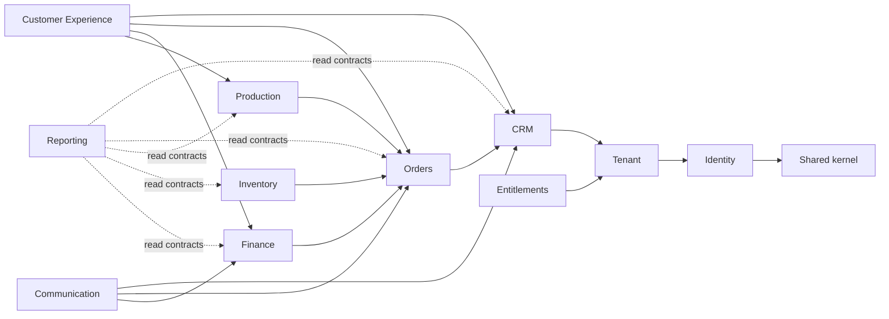

# FashionOS V2 architecture

## Decision summary

FashionOS V2 remains one React application, one FastAPI deployable, and one PostgreSQL database: a **modular monolith**. Modules own their models, schemas, services, routes, and tests inside the existing repository. They may call another module's documented application service or read interface, but should not mutate another module's tables directly.

The conceptual diagram in the Session 0 brief omitted the existing Orders module even though its dependency examples referenced it. The implemented `Order` aggregate is substantial, so V2 makes Orders explicit rather than folding it into Production.



## Module responsibilities

| Module | Owns | Does not own |
| --- | --- | --- |
| Identity | User credentials, login/refresh/logout, identity activation, cookie/JWT mechanics. | Business role, active-workspace authorization, domain permissions. |
| Tenant & Membership | Business, business settings, memberships, invitations, active-workspace validation, roles and permission policy. | Passwords or operational records. |
| CRM | Customers, measurement templates/profiles/values, archive rules, customer contact data. | Order lifecycle, outbound delivery providers. |
| Orders | Order intake, items, numbering, pricing inputs, customer/order associations, commercial lifecycle, fulfillment method and delivery/handoff history. | Item-level shop-floor activity or stock ledger. |
| Production | Production work items, item stages, priorities, effective due dates, internal activity/notes, later assignments. | Order prices, customer mutation, membership creation. |
| Inventory | Materials, suppliers, stock movements, order-material allocation/usage. | Garment/order fields or silent quantity overwrites. |
| Finance | Payments, invoice issuance/status, installment schedules, balances and Decimal-safe calculations. | Subscription billing provider state. |
| Communication | Templates, outbound communications, channel/status tracking, reminder orchestration and provider adapters. | Customer/order source-of-truth data or provider-specific fields in CRM. |
| Customer Experience | Revocable portal access and explicitly customer-safe projections. | Internal notes, unrestricted operational models, authentication by internal UUID. |
| Reporting | Bounded tenant-scoped read queries/aggregates over stable module contracts. | Operational writes, warehouse/streaming infrastructure. |
| Entitlements | Plan, subscription, feature entitlement, usage policy, provider adapters. | Operational permissions or direct coupling to Stripe/Paystack. |

## Allowed dependency direction



Rules:

1. Dependencies point toward the source-of-truth module; reverse callbacks use explicit application events or orchestration at the API/application layer, not circular imports.
2. Production may obtain customer/measurement context through the order read model or a CRM read interface; it never updates CRM.
3. Inventory references order items through allocation records; it does not add stock implementation columns to `OrderItem`.
4. Communication receives IDs/context through commands and read interfaces. CRM and Orders never import a WhatsApp/SMS/email provider.
5. Reporting uses query/read contracts and may join tables in a dedicated read service, but cannot write operational models.
6. Entitlement checks are invoked at application-service boundaries. Tenant does not depend on Entitlements, preventing a cycle.

## Shared concerns

- **Authenticated actor context:** a future dependency resolves `user_id`, active `membership_id`, `business_id`, role, and permissions. Until V2.2, V2.1 adapts the V1 user/business dependency behind the same conceptual interface.
- **Permissions:** backend policy functions in Tenant/authorization enforce named actions. Frontend hiding is only UX.
- **Tenant queries:** every owned row has or derives a business; externally addressed rows are queried with tenant predicates and return `404` across tenants.
- **Timezone:** business-local dates continue through `app.core.timezone`; UTC-aware timestamps are stored.
- **Money/currency:** `Decimal` and fixed `NUMERIC` remain authoritative; formatting stays centralized in the frontend.
- **History:** each operational module owns understandable append-oriented history or ledger tables. V2 does not adopt event sourcing or one massive polymorphic audit table.
- **Pagination/search/sorting:** shared request/response conventions, bounded page sizes, allowlisted filters/sorts, and indexed predicates.
- **Validation:** Pydantic forbids unknown write fields; services revalidate cross-record tenant and lifecycle rules transactionally.
- **Concurrency:** optimistic version checks suit production board moves; PostgreSQL row locks remain for counters, payments, stock balance changes, and last-owner safeguards.

## Database conventions

- UUID primary keys and explicit foreign keys with deliberate `CASCADE`, `RESTRICT`, or `SET NULL` behavior.
- Tenant-owned top-level/operational records carry `business_id` for direct scoping. Add composite indexes beginning with `business_id` for board/list predicates.
- Use named unique/check constraints. When redundant tenant identifiers are stored, services must validate consistency; use composite foreign keys only when they materially reduce a demonstrated risk without making migrations fragile.
- PostgreSQL enums are acceptable for small stable lifecycle vocabularies. Prefer lookup/configuration tables when customers will configure values. Every enum migration must have forward/backward compatibility notes.
- Money uses `NUMERIC(12,2)` or a justified larger precision. Measurements retain fixed precision. Never use floating point as authority.
- Store instants as timezone-aware timestamps and business calendar concepts such as due dates as dates.
- Archive mutable master data when historical references matter; do not archive append-only ledgers/history. Destructive deletion is limited to explicit retention/legal workflows.
- Financial and inventory ledgers are immutable through normal APIs. Corrections use compensating records.

## Frontend information architecture

The intended final sidebar is:

```text
Dashboard

Customers
Measurements
Orders
Production
Inventory

Communication
Reports

Team
Settings
```

Likely routes are `/dashboard`, `/customers/*`, `/measurements/*`, `/orders/*`, `/production`, `/inventory/*`, `/communication/*`, `/reports/*`, `/team/*`, and `/settings`. Only routes implemented in the current session appear in navigation. Visibility later combines permissions and entitlements, while backend enforcement remains authoritative.

TanStack Query remains the server-state layer. Each module owns stable query-key factories. Workspace switching clears tenant-owned caches before loading the next workspace. Shared UI primitives, mobile list/card alternatives, keyboard interactions, semantic badges, centralized money/date helpers, and accessible dialogs remain mandatory.

## Bounded previews for later modules

### Inventory

Initial concepts are `InventoryItem`, `Supplier`, immutable `StockMovement`, and `OrderMaterialUsage`. Current stock is a derived sum of movements, optionally maintained with a transactionally consistent cached balance only after measurement proves necessary. Allocation/usage references Orders; OrderItem receives no inventory-specific quantity columns.

### Communication

`MessageTemplate`, `Communication`, `CommunicationChannel`, and `CommunicationStatus` belong to Communication. Channels may include WhatsApp, SMS, and email, but providers sit behind replaceable adapters. V2.6 may begin with an auditable WhatsApp handoff/deep-link rather than automated sending.

### Installment plans and outfit fulfillment

V2.3 adds planned installment schedules over the existing Finance payment ledger; successful payment rows remain the authority for collections and balances. The business policy defaults to optional, and the owner may require plans for new orders. V2.4 records the chosen pickup/delivery method and order-level handoff history. The initial delivery slice does not include courier integrations or partial-garment fulfillment.

### Customer portal

Portal access uses high-entropy, revocable token material stored as a digest, expiry/status controls, tenant-safe lookup, rate limiting, and narrowly defined customer-safe response schemas. An internal UUID is never a credential. Internal notes, staff data, production activity, unrelated orders, and balances not explicitly approved for display remain excluded.

### Reporting

Start with bounded PostgreSQL aggregate/read queries, tenant predicates, indexed time ranges, and explicit metric definitions. No warehouse, Kafka, streaming, or OLAP stack. Materialized views are considered only after measured query pressure.

### Entitlements

Keep `Plan`, `Subscription`, `Entitlement`, and `Usage` conceptually separate. Operational code asks `can_use(business_id, feature)` or consumes a capability object; it never asks a payment provider directly. Stripe/Paystack integration is deferred and replaceable.

## Audit architecture

Use domain-specific records:

- membership invitation, role change, suspension, reactivation, and workspace-sensitive security actions: membership audit records;
- production stage, priority, due date, note, and later assignment: `ProductionActivity`;
- stock changes: immutable `StockMovement` with reason/reference/actor;
- communication attempts: `Communication` plus status-attempt history where retries matter;
- subscription changes: subscription lifecycle events;
- existing order status history, measurement snapshots, and payment ledger remain intact.

Each record is tenant scoped, timestamped, actor-attributed when initiated by a user, immutable through ordinary APIs, and queryable by its domain. A generic event-sourcing platform is a V2 non-goal.

## Performance boundaries

- Production board queries start at production work items, join the owning order and customer once, and return a bounded projection rather than loading full order aggregates.
- Board filters are executed in PostgreSQL. Search targets order number, customer name/phone, and garment fields with a maximum query length.
- Paginate each stage or use a bounded board window; never load all historical garments. Initial default: active work only, at most 100 total cards/25 per stage, with explicit pagination metadata.
- Fetch recent activity separately and paginate it; do not embed unbounded history in every card.
- Do not calculate balances per card with N+1 service calls. If balance is displayed, join one pre-aggregated payment/item subquery; V2.1 can omit it from the board.
- Candidate indexes are `(business_id, stage, effective_due_date)`, `(business_id, priority, stage)`, unique `order_item_id`, and activity `(business_id, production_work_item_id, created_at DESC)`. Exact DDL must be reviewed against `EXPLAIN` during implementation.

## Security architecture review

| Threat | Architectural mitigation |
| --- | --- |
| Cross-tenant production access | Actor-derived business predicate on board/detail/mutations; validate work item and order item in the same tenant; cross-tenant miss is `404`. |
| Role escalation | Named backend permissions, role allowlist, locked last-owner checks, immutable role-change audit. |
| Invitation abuse | Expiring single-use high-entropy token digest, email binding, inviter permission, rate limits, duplicate-pending constraints. |
| Workspace tampering | Browser submits membership selector only; server verifies active membership belongs to user and rotates signed cookies; every request reloads membership. |
| Portal-token leakage | Store token digest, limit scope/expiry, revoke, rate limit, avoid token logging/referrers, customer-safe schemas only. |
| Inventory manipulation | Permissioned immutable movements, transaction/locking, adjustment reasons, actor history, no direct quantity overwrite. |
| Communication spoofing | Tenant-owned templates, approved sender/provider adapter, recipient snapshot, attempt history, permission checks. |
| Finance boundary bypass | Separate payment/invoice permissions, existing row locks and tenant filters, append-only payments. |
| Entitlement bypass | Capability check in backend application services, never frontend-only or provider-webhook-only state. |

## V2 non-goals

Unless validated and scheduled later, V2 excludes native mobile apps, a marketplace, payroll, full accounting, a logistics network, supplier marketplace, e-commerce storefront, microservices, event streaming, Kubernetes, a complex workflow builder, a custom permission editor, and a full CRM marketing suite. AI remains experimental and is not part of the locked V2.1–V2.10 roadmap.
